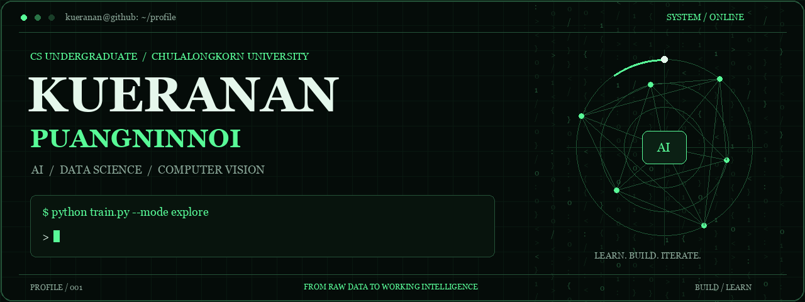
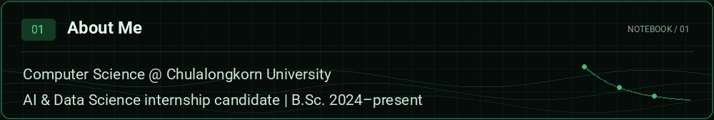
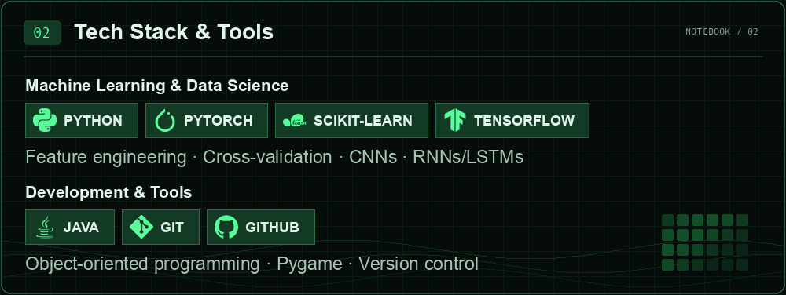
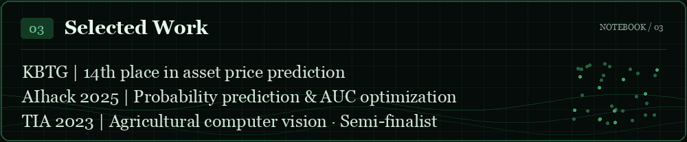
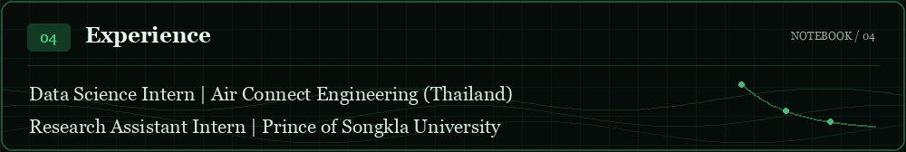
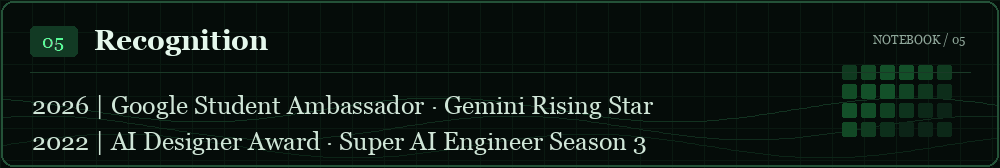
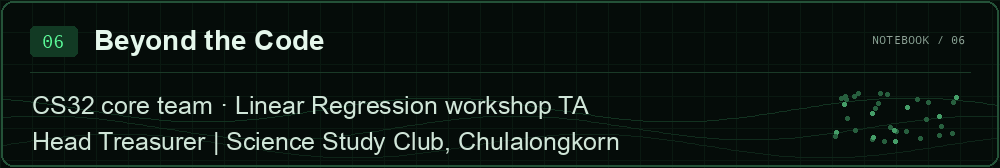

<!-- Generated by scripts/generate_sections.py. Edit its content to regenerate. -->

  

  
  
  
  

  

  

  

  

  

  

Read the plain-text profile

### 01 / About Me

Computer Science @ Chulalongkorn University.
AI & Data Science internship candidate | B.Sc. 2024–present.

### 02 / Tech Stack & Tools

**Machine Learning & Data Science:** PYTHON, PYTORCH, SCIKIT-LEARN, TENSORFLOW.
Feature engineering · Cross-validation · CNNs · RNNs/LSTMs.

**Development & Tools:** JAVA, GIT, GITHUB.
Object-oriented programming · Pygame · Version control.

### 03 / Selected Work

KBTG | 14th place in asset price prediction.
AIhack 2025 | Probability prediction & AUC optimization.
TIA 2023 | Agricultural computer vision · Semi-finalist.

### 04 / Experience

Data Science Intern | Air Connect Engineering (Thailand).
Research Assistant Intern | Prince of Songkla University.

### 05 / Recognition

2026 | Google Student Ambassador · Gemini Rising Star.
2022 | AI Designer Award · Super AI Engineer Season 3.

### 06 / Beyond the Code

CS32 core team · Linear Regression workshop TA.
Head Treasurer | Science Study Club, Chulalongkorn.

<a href="mailto:guerguer000@gmail.com">Let’s connect</a> · From raw data to working intelligence.

